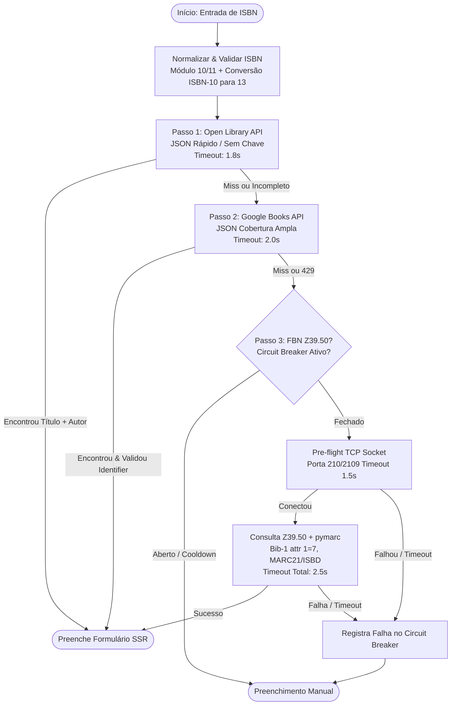

# Planejamento: Autopreenchimento Bibliográfico por ISBN (Revisado com Carbon)

Arquitetura técnica para a futura implementação da busca e autopreenchimento de metadados bibliográficos e capas na **Biblioteca Stüker**, estruturada na ordem estrita de fallback solicitada, com isolamento de falhas, proteção de timeouts e integração 100% Server-Side Rendering (FastAPI + Jinja2, HTML+CSS puro sem JavaScript).

---

## 1. Cadeia de Consulta e Ordem de Fallback

A consulta aos provedores ocorre em cascata sequencial com parada antecipada assim que um registro minimamente completo (Título + Autor) for obtido:



---

## 2. Detalhamento de Cada Etapa e Mitigação de Riscos

### Passo 1: Open Library API (Rápido / JSON / Sem Chave)
- **Endpoint:** `GET https://openlibrary.org/api/books?bibkeys=ISBN:{isbn}&format=json&jscmd=data`
- **Timeout:** `1.8s` (conexão `1.0s`).
- **Vantagens:** Gratuita, sem chave, veloz e já fornece URLs diretas de capa (`cover.large`).
- **Riscos & Correções:**
  - Evitar a rota `/isbn/{isbn}.json` pura, pois exige chamadas extras para resolver os nomes dos autores (`/authors/OL...`).
  - Lidar com retornos parciais (ex: registro contendo apenas título, sem autor). Se não tiver autor, os dados parciais são mantidos enquanto o fluxo tenta enriquecer no Passo 2.

### Passo 2: Google Books API (Cobertura Ampla / JSON)
- **Endpoint:** `GET https://www.googleapis.com/books/v1/volumes?q=isbn:{isbn}`
- **Timeout:** `2.0s` (conexão `1.0s`).
- **Vantagens:** Enorme cobertura editorial mundial e brasileira moderna; dados de sinopse e capa.
- **Riscos & Correções:**
  - **Falso positivo de busca aproximada:** O Google Books pode retornar um livro que apenas *cita* o ISBN no texto. **Mitigação:** Validação estrita do array `volumeInfo.industryIdentifiers` conferindo se o ISBN bate exatamente com o pesquisado.
  - **Rate Limiting:** Suporte opcional à variável de ambiente `GOOGLE_BOOKS_API_KEY` para evitar restrições em IPs de nuvem.

### Passo 3: Fundação Biblioteca Nacional — FBN (Z39.50 / MARC21)
- **Servidor:** `z3950.bn.gov.br` (ou IP institucional do Pergamum/Sophia da FBN), portas `210`, `2100` ou `2109`, base `acervo` ou `bn`.
- **Protocolo:** Z39.50 (ISO 23950, TCP binário ASN.1/BER) com sintaxe de registro USMARC / ISO 2709.
- **Riscos Críticos & Soluções Arquiteturais:**
  1. **Evitar dependências C instáveis (YAZ):** Utilizar `PyZ3950-py3` ou client TCP puro combinado com **`pymarc`** (Python puro, moderno e ativo).
  2. **Pre-flight Socket TCP (1.5s):** Testa a conectividade na porta TCP antes de iniciar o handshake ASN.1. Se a porta estiver fechada ou bloqueada por firewall de saída, aborta em 1.5s sem pendurar threads.
  3. **Circuit Breaker em Memória:** Se o Z39.50 da FBN falhar por timeout ou queda por 3 vezes consecutivas, o provedor entra em cooldown por 5 minutos, protegendo os usuários seguintes de esperarem o timeout governamental.
  4. **Parsing MARC21 e Limpeza ISBD:**
     - **Título/Subtítulo (`245` $a, $b):** Remoção de pontuação de catalogação ISBD final (` /`, ` :`, pontos).
     - **Autores (`100`, `110`, `700` $a):** Normalização de nomes invertidos (`"Assis, Machado de,"` -> `"Machado de Assis"`) e captura de múltiplos coautores.
     - **Publicação (`264` ind2='1' RDA moderno com fallback para `260` AACR2):** Extração de editora ($b), local ($a) e regex `\b(1[5-9]\d{2}|20\d{2})\b` para o ano ($c).
     - **Páginas (`300` $a):** Extração numérica via regex de expressões como `xxiv, 342 p.`.
     - **Assuntos/Tags (`650` $a, $x):** Cabeçalhos temáticos oficiais da Biblioteca Nacional convertidos para tags livres.

---

## 3. Orçamento de Latência (Latency Budget)

Para manter a experiência ágil no navegador sem JavaScript, o tempo total máximo de resposta é limitado a **6 segundos**:

| Passo | Provedor | Timeout Conexão | Timeout Total | Ação em Caso de Falha |
| :--- | :--- | :---: | :---: | :--- |
| **Passo 1** | Open Library API | `1.0s` | `1.8s` | Avança para Passo 2 |
| **Passo 2** | Google Books API | `1.0s` | `2.0s` | Se sem dados, avança para Passo 3 |
| **Passo 3** | FBN Z39.50 / MARC21 | `1.5s` | `2.5s` | Degradação para preenchimento manual |

---

## 4. Integração SSR no FastAPI e Jinja2 (HTML+CSS Puro)

Preservando a estética Tumblr 2012 e a regra de zero JavaScript:

### 4.1. Fluxo de Navegação
1. Na página de cadastro ([`admin_livro_form.html`](file:///mnt/dados/projetos/biblioteca_stuker/frontend/templates/admin_livro_form.html)), o usuário encontra no topo um card estilizado:
   - Campo de texto `buscar_isbn` (com foco automático e compatível com leitor de código de barras físico).
   - Botão `Buscar Dados` (submete via `GET /admin/livros/novo?buscar_isbn=...`).
2. O FastAPI processa o pipeline de fallback de forma assíncrona/segura.
3. A página recarrega com:
   - Um banner de feedback: `✓ Metadados obtidos com sucesso via Google Books` (ou `via Fundação Biblioteca Nacional`).
   - Todos os inputs do formulário já preenchidos (título, subtítulo, autor, editora, ano, páginas, ISBN, sinopse, tags e URL da capa).
4. O administrador confere, faz qualquer ajuste desejado e clica em `Cadastrar Obra` (`POST /admin/livros/novo`), gravando diretamente no PostgreSQL.

---

## 5. Estrutura de Arquivos Proposta para a Implementação

```text
backend/
├── servicos/
│   ├── isbn/
│   │   ├── __init__.py
│   │   ├── normalizador.py     # Validador módulo 10/11 e conversor de ISBN
│   │   ├── marc_parser.py      # Sanitizador ISBD e parser de campos MARC21
│   │   ├── openlibrary.py      # Passo 1: Adapter HTTP
│   │   ├── googlebooks.py      # Passo 2: Adapter HTTP
│   │   ├── fbn_z3950.py        # Passo 3: Adapter Z39.50 + Circuit Breaker
│   │   └── orquestrador.py     # Pipeline sequencial de fallback
│   ├── livros_servico.py
│   └── ...
└── rotas/
    └── admin_rotas.py          # GET /admin/livros/novo tratando buscar_isbn
```

---

## 6. Dependências Necessárias (quando for implementar)

- `requests` ou `httpx` (já presentes no projeto).
- `pymarc` (biblioteca Python pura para decodificação e extração de registros MARC21).
- `PyZ3950-py3` (para comunicação de rede via protocolo Z39.50 com a FBN).
